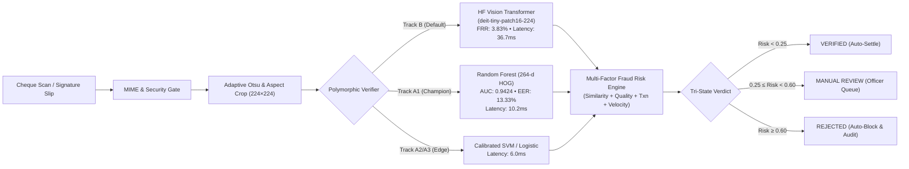

# Neerav Jain

### Applied Machine Learning Engineer & Systems Researcher
**B.Tech CSE — Artificial Intelligence & Machine Learning**

[](https://github.com/neeravjain91-jpg)
[](https://aeropulse-test.vercel.app)
[](https://code-gules-three.vercel.app)

I build **physics-informed machine learning models, spatiotemporal forecasting systems, computer vision pipelines, and production AI platforms**. My work emphasizes **leakage-safe experimental protocols, empirical error analysis, domain boundary transparency, and end-to-end system deployability** from telemetry and raw data to APIs and interactive control stations.

---

## 🏛️ Engineering & Research Philosophy

```
  Data Integrity & Ingestion
  (Check-gated, Causal Masking, Sensor Veto)
               ↓
  Leakage-Safe Partitioning
  (Chronological Splits, Purge Buffers, Disjoint Grouping)
               ↓
  Domain-Informed Modeling
  (Thermodynamic / Geophysical Physics + Deep Ensembles + Tree Baselines)
               ↓
  Empirical Calibration & Validation
  (Platt Scaling, Block Bootstrap 95% CI, Adversarial Holdouts)
               ↓
  Production Deployment & Systems Engineering
  (FastAPI / Next.js, WebGL Telemetry, Cryptographic Audit Ledgers)
```

1. **Measure Before Claiming**: Every reported metric must cite the exact evaluation partition, split protocol, ground-truth provenance, and confidence intervals. Synthetic benchmark results must never be conflated with real-world operating distributions.
2. **Eliminate Data Leakage**: Standardizers fit only on training windows; causal history enforces strict $t < T$ boundaries; temporal buffers isolate sequence receptive fields from evaluation folds; and biometrics test strictly across writer-disjoint cohorts.
3. **Analyze Where Systems Fail**: Genuine progress requires understanding error envelopes—such as thermocline variance peaks in ocean modeling, false-alarm trade-offs under high-speed flight transients, or candidate recall drops during entity blocking.
4. **Build Beyond the Notebook**: Machine learning algorithms become reliable assets only when packaged with type-safe APIs, robust unit/integration tests, real-time dashboards, and immutable audit trails.

---

## 🚀 Flagship Research & Engineering Projects

### 1. 🚁 [AeroPulse-X](https://github.com/neeravjain91-jpg/final-aeropulse) — Mission-Aware AI Digital Twin for UAV Engine Health
> **Smart India Hackathon (SIH26054) Research Prototype**  
> **Status:** Completed & Certified Build • **Test Suite:** `308 passed, 0 failed` • **Deployment:** [Live Production Dashboard](https://aeropulse-test.vercel.app) | [FastAPI Interactive Docs](https://aeropulse-test.vercel.app/docs)  
> *Canonical Repositories:* [`final-aeropulse`](https://github.com/neeravjain91-jpg/final-aeropulse) / [`aeropulse-test`](https://github.com/neeravjain91-jpg/aeropulse-test) *(Predecessor: `AeroPulse-X`)*

An AI-enabled, real-time Digital Twin and predictive health-monitoring platform for MALE-UAV aero-piston engines (modeled on the four-cylinder Rotax 914 Turbo). Combines reduced-order thermodynamic cycle modeling, dual-layer AI diagnostics, unsupervised anomaly detection, peer cross-sensor trust verification, and physics-stress weighted Remaining Useful Life (RUL) prognostics.

```text
UAV Mission Telemetry / Dynamic Atmospheric Flight Simulator
                           ↓
Reduced-Order Piston Engine (Thermodynamic Otto Cycle, Altitude & Throttle Coupling)
                           ↓
Context-Aware Reference Twin ──► Expected State vs. Observed Residuals
                           ↓
Hybrid Diagnostic Fusion (HistGradientBoosting 0.70 + TCN Residual Classifier 0.30)
                           ↓
Cross-Sensor Peer Trust Engine (Multi-Channel Cross-Validation & Sensor Veto)
                           ↓
Physics-Stress Weighted RUL Prognostics (Strict Monotonicity & Zero-Leakage)
                           ↓
Tactical Ground Control Station (GCS Dashboard, Three.js WebGL 3D Twin, Mission Replay)
```

#### Empirical Performance Envelope (Domain-Separated)

| Metric | Synthetic Fault Trajectories (ODE Engine) | Real NASA ACES Altus II Flights |
| :--- | :---: | :---: |
| **Multi-Class Accuracy** | **99.81%** | **89.47%** *(89.19% standalone HGB)* |
| **Balanced Accuracy** | **99.20%** | **89.29%** *(87.67% standalone HGB)* |
| **Critical Fault Recall** | **99.42%** *(512 / 515)* | **95.68%** *(91.31% standalone HGB)* |
| **Critical Fault Precision** | **98.84%** *(512 / 518)* | **63.88%** *(70.78% standalone HGB)* |
| **Critical Fault F1-Score** | **0.991** | **0.766** *(0.797 standalone HGB)* |
| **Anomaly Detection AUROC** | **0.991** | **0.960** |
| **False Alarm Rate (FAR)** | **0.4%** | **5.79%** |

* **Digital Twin Physical Fidelity:** Evaluated against 173,878 real flight frames from NASA ACES Flights 1–12; achieves Brake Power MAE of **2.88 kW** ($-38.1\%$ error reduction over baseline), MAP RMSE of **1.62 kPa**, and EGT P95 error of **18.4 °F**.
* **Prognostic RUL Benchmark:** Hybrid Physics-Stress RUL Engine evaluated across 60 degradation trajectories (1,155 evaluation points) achieves MAE of **6.98 h** ($-43.9\%$ over linear baseline), **100.00% step monotonicity**, and zero upward jumps during monotonic degradation.
* **Inference Profiling:** Mean end-to-end CPU pipeline latency of **19.9 µs** (throughput $> 49,000$ frames/sec), comfortably beating the 10 ms real-time telemetry deadline by $12.3\times$.
* **Dataset Domain Isolation:** NASA ACES (Altus II flight data, 0 ground-truth failures; critical alerts indicate transient envelope exceedances), CWRU Bearing Data (proxy electric motor rig for vibration DSP only), ALFA UAV (proxy airframe actuator failures), and NASA C-MAPSS (turbofan method validation).
* **Research Disclosure:** Developed as an SIH research software demonstrator; not certified for operational flight release or airworthiness sign-off.

---

### 2. 🌊 [-Satellite-Embedding](https://github.com/neeravjain91-jpg/-Satellite-Embedding) — Subsurface Ocean Temperature Reconstruction
> **Physics-Informed Oceanographic Spatiotemporal Deep Learning**  
> **Status:** Production Release • **Test Suite:** `106 passed, 0 failed` • **Deployment:** [Live Interactive Prototype](https://code-gules-three.vercel.app)  
> *Canonical Repository:* [`-Satellite-Embedding`](https://github.com/neeravjain91-jpg/-Satellite-Embedding)

End-to-end scientific deep learning framework reconstructing depth-resolved subsurface ocean potential temperature ($\theta_o$) across the **North Indian Ocean** (Arabian Sea, Bay of Bengal, Equatorial corridor) from surface-only multi-satellite telemetry.

```text
7 Multi-Satellite Surface Predictors (SST, SSS, SSH/SLA, Current U/V, Wind U/V)
                                    ↓
Causal 5-Day × 3×3 Spatiotemporal Input Window (X ∈ ℝ^{B × 5 × 7 × 3 × 3})
                                    ↓
Spatial Conv2D Encoder (Time-Distributed 2D Convolutions → Adaptive Pooling)
                                    ↓
2-Layer Causal GRU Network (Captures Upper-Ocean Wind-Driven Mixing Dynamics)
                                    ↓
128-Dimensional Ocean Latent Embedding Bottleneck (LayerNorm Regularized)
                                    ↓
Vertical Column MLP Decoder (Reconstructs 15 Discrete Depths: 0 m to 1000 m)
                                    ↓
In-Situ Ground-Truth Validation (Copernicus GLORYS12V1 Reanalysis + Global Argo Floats)
```

#### Rigorous Leakage-Controlled Benchmark (Days 313–365, Year 2020)

Evaluated across an untouched, strictly chronological test partition isolated by **6-day purge buffers** ($T_{\text{purge}} > T_{\text{causal}}$) to prevent temporal autocorrelation leakage across 166,400 active 3D ocean cells:

| Model ID | Architecture Description | Parameters | Test Column RMSE (°C) | Improvement vs Climatology | Improvement vs Best ML |
| :--- | :--- | :---: | :---: | :---: | :---: |
| **B0** | Day-0 Persistence Baseline | 0 | 1.5220 | $-20.97\%$ | $-47.94\%$ |
| **B1** | Daily Mean Climatology | 0 | 1.2582 | *Reference Baseline* | $-22.30\%$ |
| **B2** | Ridge Linear Regression ($\alpha=10^5$) | 120 | 1.0295 | $+18.18\%$ | $-0.07\%$ |
| **B3** | Random Forest Regressor (750 trees) | 13.2M nodes | 1.0452 | $+16.93\%$ | $-1.59\%$ |
| **B4** | LightGBM Gradient Boosting (750 trees) | 750 trees | 1.0288 | $+18.23\%$ | *ML Baseline* |
| **B5** | Pointwise 3-Layer MLP | 26.7K | 1.5524 | $-23.38\%$ | $-50.90\%$ |
| **B6** | Spatial Conv2D CNN ($3\times3$ patch) | 30.9K | 1.2702 | $-0.95\%$ | $-23.46\%$ |
| **B7** | Temporal GRU (5-day causal window) | 44.1K | 1.5320 | $-21.76\%$ | $-48.91\%$ |
| **B8** | **Spatiotemporal Embedding Network** | **203.7K** | **0.9800** | **+22.11%** | **+4.74%** |

* **Statistical Significance:** Absolute error reduction $\Delta\text{RMSE} = -0.2782\ ^\circ\text{C}$ vs. Climatology; 7-day block bootstrap (1,000 resamples) confirms $95\%$ CI $[-0.3957, -0.1756]\ ^\circ\text{C}$ with $p < 0.001$.
* **Depth-Stratified Analysis:** Error profile documented across all 15 layers—ranging from $0.4369\ ^\circ\text{C}$ at the surface boundary layer ($0\text{ m}$) to peak variance at the seasonal thermocline ($1.8110\ ^\circ\text{C}$ at $75\text{ m}$).
* **Certified Remote Sensing Sources:** OSTIA L4 SST, Copernicus Multi-Observation SSS, CMEMS DUACS Altimetry, OSCAR Currents, CCMP V3.1 Winds, validated against Global Argo profiling CTD floats.

---

### 3. 🔥 [major-forest-fire](https://github.com/neeravjain91-jpg/major-forest-fire) — Event-Centric Multimodal Spatiotemporal Wildfire Intelligence
> **Spatiotemporal Wildfire Persistence & Disjoint Evaluation Framework for Sovereign India (2018–2025)**  
> **Status:** Research Release • **Test Suite:** `60 passed, 0 failed`  
> *Canonical Repository:* [`major-forest-fire`](https://github.com/neeravjain91-jpg/major-forest-fire) *(Supersedes: `indian-forest-fire-prediction-n`, `india-forest-fire-prediction`)*

An event-centric spatiotemporal wildfire forecasting framework integrating **NASA FIRMS VIIRS 375m** satellite telemetry, **Copernicus ERA5-Land** multi-timescale atmospheric reanalysis (1d, 3d, 7d drying windows, vapor pressure deficit, topsoil drought index), and authoritative **NOAA ETOPO 2022 + SRTM v3** digital elevation geomorphology (slope via Horn 1981, Topographic Ruggedness Index via Riley 1999).

```text
VIIRS 375m Telemetry + ERA5-Land Reanalysis + NOAA ETOPO 2022 Digital Elevation
                                    ↓
Strict Causal History Search (Binary Search over historical records t < T; Zero-Lookahead)
                                    ↓
2×2 Factorial Matrix (HGB vs. LightGBM × 31-Feature Baseline vs. 39-Feature Multimodal)
                                    ↓
Connected-Component Spatiotemporal Event Clustering (Spatial proximity ≤ 25 km at T+1d)
                                    ↓
Parametric Platt Calibration (Regularized ECE reduction over non-parametric isotonic)
                                    ↓
Leave-One-Geographic-Regime-Out (LOGRO) Spatial Cross-Validation across 6 Indian Regimes
```

#### Controlled Factorial Benchmark (Chronological Test Holdout: 2024–2025, $N = 31,525$)

| Experiment | Model Architecture | Features | Calibration | Accuracy | F1-Score | ROC-AUC | PR-AUC | Brier Score | ECE |
| :--- | :--- | :---: | :--- | :---: | :---: | :---: | :---: | :---: | :---: |
| **Exp A** | HistGradientBoosting | 31 | Platt | 56.29% | 59.95% | 59.08% | 57.36% | 0.2426 | 0.0092 |
| **Exp B** | HistGradientBoosting | 39 | Platt | 57.85% | 58.67% | 61.79% | 60.57% | 0.2383 | 0.0173 |
| **Exp C** | LightGBM | 31 | Platt | 56.40% | 59.78% | 59.25% | 57.73% | 0.2422 | **0.0088** |
| **Exp D** | **LightGBM (Primary Major)** | **39** | **Platt** | **58.35%** | **60.06%** | **62.31%** | **61.14%** | **0.2371** | **0.0143** |
| *Ref* | Multi-Scale BiGRU Deep Net | Tensors | Raw | 55.91% | 57.14% | 58.92% | 57.61% | 0.2434 | 0.0190 |

* **Empirical Feature Main Effect:** Multimodal geomorphological + atmospheric drying features yield $\Delta\text{ROC-AUC} = +2.89\%$ ($95\%$ bootstrap CI $[+2.40\%, +3.35\%]$).
* **Occurrence vs. Event Persistence Discovery:** Predicting arbitrary forward ignition ($T+24\text{h}$) from synoptic meteorology alone is physically ill-posed ($53.13\%$ ROC-AUC, $2.57\%$ PR-AUC). In contrast, connected-component **event persistence ($24\text{h}$)** achieves **$68.39\%$ ROC-AUC**, **$11.90\%$ PR-AUC**, and **$18.0\%$ Top-100 Precision** ($2.6\times$ baseline prevalence).
* **LOGRO Spatial Transfer:** Leave-One-Geographic-Regime-Out CV yields a macro cross-regional ROC-AUC of **$64.20\% \pm 0.97\%$** across 6 distinct regimes (Central, Western Ghats, Northeast, North, East, Northwest), cutting spatial transfer variance in half compared to the baseline.
* **Methodological Transparency:** Tested on a balanced case-control sample ($P=0.50$ at reference time $T$); real-world unadjusted daily cell incidence is $< 0.05\%$. Academic research demonstrator, not an operational civil emergency system.

---

### 4. ✍️ [SIGNATURE VMAKE](https://github.com/neeravjain91-jpg/signature-v) — Banking Biometrics & Multi-Factor Fraud Risk Engine
> **Writer-Independent Biometric Signature Verification Platform Conforming to Bank Muscat BRD**  
> **Status:** Production Release • **Test Suite:** `53 passed, 0 failed`  
> *Canonical Repository:* [`signature-v`](https://github.com/neeravjain91-jpg/signature-v) *(Mirrored as `signature-verification`; earlier prototype referred to as `SYNAPSE`)*

An enterprise banking operations platform engineered for cheque clearing, counter withdrawals, and high-value wire transfers. Features a dual-track machine learning suite, multi-factor fraud risk scoring, tri-state automated decisioning, and cryptographic audit ledgers across a 7-route modular UI.



#### Empirical Test Cohort Benchmark (CEDAR Writers 46–55, 1,200 Open-Set Pairs)

| Metric | Track B: HF Vision Transformer (ViT) | Track A1: Random Forest Classifier | Track A2: Classical SVM | Track A3: Logistic Regression |
| :--- | :---: | :---: | :---: | :---: |
| **Operational Designation** | **Production Enterprise Default** | **Accuracy Champion** | **Edge / Offline Teller** | **Ultra-Light Baseline** |
| **ROC-AUC** | 0.7947 | **0.9424** | 0.8574 | 0.8808 |
| **Equal Error Rate (EER)** | 27.67% | **13.33%** | 19.00% | 18.83% |
| **Accuracy at Threshold** | 64.50% | **82.92%** | 79.17% | 80.50% |
| **False Acceptance Rate (FAR)** | 67.17% | 30.33% | 28.50% | **27.00%** |
| **False Rejection Rate (FRR)** | **3.83%** *(Low Friction)* | **3.83%** | 13.17% | 12.00% |
| **True Acceptance Rate (TAR)** | **96.17%** | **96.17%** | 86.83% | 88.00% |
| **F1-Score** | 0.7304 | **0.8492** | 0.8065 | 0.8186 |
| **Inference Latency (CPU)** | 36.66 ms | 10.23 ms | 6.03 ms | **6.00 ms** |
| **Model Disk Footprint** | 21.73 MB | 2.39 MB | 1.90 MB | **0.02 MB** |

* **Multi-Factor Risk Formulation:** $\text{Risk}_{\text{composite}} = 0.50 \cdot R_{\text{sim}} + 0.15 \cdot (1 - Q_{\text{img}}) + 0.25 \cdot R_{\text{txn}} + 0.10 \cdot R_{\text{behavior}}$, integrating biometric margin deficit, Laplacian blur variance ($\sigma_L^2$), transaction tier exposure, and velocity.
* **Dual Operational Modes:** Single reference verification vs. 3-specimen gallery verification (`max_similarity`, `mean_similarity`).
* **Enterprise Infrastructure:** 7 dedicated pages (Overview, Manual Workflow, Cheque Studio, Model Comparison, Compliance Queue, Audit Timeline, Model Registry), 3NF PostgreSQL/SQLite schema, and tamper-evident SHA-256 non-repudiation audit ledger.

---

### 5. 🔎 [DeepResolve ER](https://github.com/neeravjain91-jpg/ml-amazon) — Large-Scale Business Entity Resolution
> **Amazon ML Challenge 2026** • **Team: DeepResolve ER**  
> **Status:** Completed Competition Pipeline • **Final Validation Macro F0.5:** **0.81172**  
> *Canonical Repository:* [`ml-amazon`](https://github.com/neeravjain91-jpg/ml-amazon)

High-precision, large-scale entity resolution system designed to resolve noisy business records across three heterogeneous enterprise record sources without gold training identifiers.

* **Multi-Channel Inverted Index Blocking:** Implements normalized exact matching, legal-suffix stripping, token sorting, compact alphanumeric domain stems, and clean numeric address co-occurrence blocking ($85.62\%$ candidate recall, **$99.991\%$ reduction ratio**).
* **Dense 30-Dimensional Pairwise Feature Extractor:** Extracts character 3-gram Dice similarities, token Jaccard coefficients, length ratios, numeric set agreement, and multiplicative cross-field interaction terms.
* **Hard-Negative Mining & GBDT Classification:** Samples candidate false positives directly from the blocking pool to train an MIT-licensed LightGBM classifier.
* **Adaptive Score-Margin Decision Engine:** Calibrated threshold $\tau = 0.94$, relative margin $\Delta = 0.05$, and maximum cardinality cap $K \le 5$, protecting singleton records (**$89.93\%$ singleton accuracy**) while capturing multi-entity clusters ($1 \le k \le 11$).

| System Configuration | Validation Macro F0.5 | Precision | Recall | Singleton Accuracy |
| :--- | :---: | :---: | :---: | :---: |
| Baseline 1 (Raw Exact String Match) | 0.05587 | 0.00005 | 0.00001 | 1.00000 |
| Baseline 2A (Normalized Exact Match) | 0.08370 | 0.04560 | 0.01347 | 1.00000 |
| Baseline 2B (Normalized Name Only) | 0.32161 | 0.40117 | 0.21958 | 0.64190 |
| Baseline 2C (Legal-Stripped Name) | 0.40452 | 0.46832 | 0.42761 | 0.38675 |
| Baseline 2D (Token-Sorted Name) | 0.41724 | 0.48015 | 0.44928 | 0.37422 |
| **Final Solution (DeepResolve ER)** | **0.81172** | **0.88801** | **0.66169** | **0.89933** |

---

### 6. 🤝 [HackMate](https://github.com/neeravjain91-jpg/hackmate) — Hackathon Team Collaboration & Shared Work Library
> **Full-Stack Hackathon Collaboration Platform**  
> **Status:** Active Release • **Tech Stack:** Next.js 14 (App Router), TypeScript, React 18, Tailwind CSS, Supabase / Local Storage, Vitest  
> *Canonical Repository:* [`hackmate`](https://github.com/neeravjain91-jpg/hackmate)

A web collaboration platform engineered specifically for hackathon teams of 4–6 members. Eliminates lost model weights, unsynced code, and chaotic ZIP file sharing through a centralized, access-controlled workspace.

* **Concurrency-Safe Team Limits:** Hard database and mutex cap of 6 members maximum per project, atomically guarded against race conditions during team joins.
* **Shared Work Library:** Allows teammates to publish code, trained ML checkpoints, datasets, and UI components with explicit semantic versions, dependency tags, and usage instructions without silent overwrites.
* **Dual Storage Architecture:**
  1. *Local Persistent Driver:* Zero-config persistent JSON database with atomic file locks and private disk storage.
  2. *Supabase Cloud Driver:* Supabase Auth, PostgreSQL with Row Level Security (RLS), and private S3-compatible object buckets (`hackmate-contributions`).
* **Byte-for-Byte Integrity & Access Control:** Relational metadata records SHA-256 checksums; unauthorized cross-project file downloads are strictly rejected with HTTP 403 Forbidden.
* **Leader Pipeline:** Task assignment, submission review workflow (`In Progress` → `Submitted` → `Approved` / `Changes Requested`).

---

### 7. 🛣️ [Road Guardian AI](https://github.com/neeravjain91-jpg/Road-Guardian-AI-) — Automated Road Hazard & Pothole Detection
> **India AI Impact Buildathon**  
> **Status:** Prototype Release • **Tech Stack:** YOLO, OpenCV, Python, Pandas, GPS Modules  
> *Canonical Repository:* [`Road-Guardian-AI-`](https://github.com/neeravjain91-jpg/Road-Guardian-AI-)

Applied computer-vision edge system transforming mobile camera feeds into automated municipal hazard sensors:
* Real-time road surface hazard detection via fine-tuned YOLO object detection.
* Confidence-filtered bounding box detection ($> 0.50$ threshold) coupled with hardware GPS geotagging (Latitude, Longitude, Timestamp).
* Visual evidence preservation with automated frame snapshots and structured CSV report generation for municipal road maintenance prioritization.

---

## 🗂️ Repository Lineage & Technical Audit Summary

To ensure complete transparency and prevent confusion across iterative versions, the table below documents the audit status, canonical repositories, and relationships across all repositories in this profile:

| Project Theme | Canonical Repository | Predecessor / Duplicate Repositories | Audit & Resolution Notes |
| :--- | :--- | :--- | :--- |
| **UAV Digital Twin** | [`final-aeropulse`](https://github.com/neeravjain91-jpg/final-aeropulse) / [`aeropulse-test`](https://github.com/neeravjain91-jpg/aeropulse-test) | `AeroPulse-X`, `AeroPulse`, `demo-aeropluse` | `final-aeropulse` and `aeropulse-test` contain the certified 308-test build, deployed on Vercel (`https://aeropulse-test.vercel.app`). `AeroPulse-X` and `AeroPulse` represent earlier intermediate commits. |
| **Ocean Subsurface ML** | [`-Satellite-Embedding`](https://github.com/neeravjain91-jpg/-Satellite-Embedding) | *None (Independent project)* | Standalone research project reconstructing 3D ocean temperature from 7 satellite streams. 106 passed tests, deployed on Vercel (`https://code-gules-three.vercel.app`). |
| **Wildfire Intelligence** | [`major-forest-fire`](https://github.com/neeravjain91-jpg/major-forest-fire) | `indian-forest-fire-prediction-n`, `india-forest-fire-prediction`, `updated-forest-fire-prediction`, `forest-fire-prediction-` | `major-forest-fire` is the authoritative major project (DEM geomorphology, 39 multimodal features, LOGRO cross-validation, 60 tests). Earlier repos used toy Algerian data or simpler non-DEM temporal models. |
| **Biometric Verification** | [`signature-v`](https://github.com/neeravjain91-jpg/signature-v) | `signature-verification` | `signature-v` and `signature-verification` are identical mirrors (same commit `8bd5b10`). Canonical title is SIGNATURE VMAKE (previously SYNAPSE), aligned with Bank Muscat BRD specifications. |
| **Entity Resolution** | [`ml-amazon`](https://github.com/neeravjain91-jpg/ml-amazon) | `mlproject` | Canonical repository for Amazon ML Challenge 2026 (DeepResolve ER). Validated Macro F0.5: 0.81172. |
| **Hackathon Platform** | [`hackmate`](https://github.com/neeravjain91-jpg/hackmate) | *None (Independent project)* | Full-stack Next.js 14 App Router, TypeScript, and Supabase/Local storage collaboration tool. |
| **Road Inspection CV** | [`Road-Guardian-AI-`](https://github.com/neeravjain91-jpg/Road-Guardian-AI-) | *None (Independent project)* | India AI Impact Buildathon computer vision and GPS pothole logging system. |
| **Coursework / Static** | `Portfolio`, `fsd`, `fsd-idcard`, `Task-manager`, `resume-` | *Academic Coursework* | Early foundational academic coursework and UI templates; omitted from featured projects. |

---

## 🛠️ Technical Skills & Tooling Matrix

| Domain | Technologies & Frameworks |
| :--- | :--- |
| **Machine Learning & Modeling** | `Scikit-learn`, `LightGBM`, `HistGradientBoosting`, `PyTorch`, `Hugging Face Transformers` (`DeiT`, `ViT`), `Metric Learning`, `Isolation Forest`, `Random Forest`, `Platt Calibration` |
| **Deep Learning & Architectures** | `CNNs`, `Causal GRU / BiGRU`, `Temporal Convolutional Networks (TCN)`, `TCN Autoencoders`, `Multi-Head Attention`, `Siamese Metric Projections` |
| **Earth Observation & Geospatial** | `NASA FIRMS VIIRS 375m`, `Copernicus ERA5-Land`, `Copernicus GLORYS12V1`, `OSTIA SST`, `CMEMS DUACS Altimetry`, `OSCAR Currents`, `CCMP V3.1 Winds`, `NOAA ETOPO 2022 / SRTM v3 DEM`, `Global Argo CTD Floats`, `xarray`, `netCDF4`, `GeoPandas` |
| **Full-Stack & Systems Engineering** | `FastAPI`, `Next.js 14 (App Router)`, `React 18`, `TypeScript`, `Flask`, `Three.js WebGL`, `Tailwind CSS`, `Uvicorn`, `WebSockets`, `REST APIs` |
| **Data & Storage Systems** | `PostgreSQL` (with RLS), `SQLite` (3NF Schemas), `Pandas`, `NumPy`, `SciPy`, `Supabase Storage`, `SHA-256 Cryptographic Ledgers` |
| **DevOps, Testing & Quality** | `Git`, `GitHub Actions`, `Docker`, `Pytest` (308 + 106 + 60 + 53 unit/integration suites), `Vitest`, `Vercel Fluid Compute` |
| **Evaluation Protocols** | `Chronological Purge Buffers`, `Leave-One-Geographic-Regime-Out (LOGRO)`, `Writer-Disjoint Cohort Benchmarks`, `Block Bootstrapping (95% CI)`, `Hard-Negative Mining` |

---

## 📬 Contact & Connect

* **GitHub:** [@neeravjain91-jpg](https://github.com/neeravjain91-jpg)
* **Email:** [neeravjain91@gmail.com](mailto:neeravjain91@gmail.com)
* **Degree:** B.Tech in Computer Science & Engineering (Artificial Intelligence & Machine Learning)
